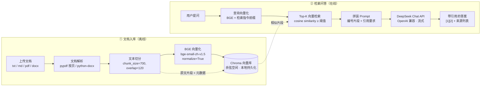

# 基于 LLM API 的 RAG 知识库问答系统

一个可直接部署的中文知识库问答系统：上传 txt / md / pdf / docx 文档，系统自动解析、切分并用 **BGE 中文向量模型** 建立本地向量库；提问时先做语义检索，再把命中的原文片段拼进 Prompt，调用 **DeepSeek** 生成答案，并在回答中标注引用来源（文件名 + 原文片段）。


---

## 1. 项目用途

- **私有知识库问答**：把产品手册、规章制度、技术文档、论文等资料变成可对话的知识库，答案限定在已上传内容内，降低大模型幻觉。
- **可溯源**：每条结论都带 `[1]`、`[2]` 形式的引用编号，界面下方展示对应文件名、片段编号、相似度与原文。
- **开箱即用**：单机即可运行，向量库落在本地目录，无需额外部署数据库或向量服务。
- **适合二次开发**：FastAPI 分层结构 + SSE 流式输出，便于接入企业微信、飞书、内部系统或改造成多知识库 / 多租户版本。

典型场景：企业内部知识助手、客服话术检索、课程资料问答、招投标文件比对、个人第二大脑。

---

## 2. 技术栈

| 模块 | 选型 | 说明 |
| --- | --- | --- |
| Web 框架 | FastAPI + Uvicorn | 异步接口、自动生成 Swagger 文档 |
| 编排框架 | LangChain（langchain-core / text-splitters / openai / chroma） | 文档、切分器、Embeddings 适配、Prompt 组装 |
| 向量数据库 | Chroma | 本地持久化（`data/chroma`），余弦相似度检索 |
| Embedding | BGE 中文模型 `BAAI/bge-small-zh-v1.5`（sentence-transformers） | 中文语义向量，CPU 可跑，首次运行自动下载 |
| 大模型 | DeepSeek `deepseek-chat`（OpenAI 兼容接口） | 通过 `langchain-openai` 的 `ChatOpenAI` 调用，支持流式 |
| 文档解析 | pypdf / python-docx | PDF 按页解析，DOCX 读取段落与表格 |
| 前端 | 原生 HTML + CSS + JavaScript | 无构建步骤，SSE 流式渲染、引用折叠 |
| 配置 | pydantic-settings + .env | 全部参数走环境变量，仓库内不含任何密钥 |

---

## 3. 部署步骤

### 3.1 环境要求

- Python **3.10+**（推荐 3.11 / 3.12），Windows / macOS / Linux 均可
- 可访问 DeepSeek API 与 HuggingFace（或配置镜像加速模型下载）
- 首次运行会下载约 100 MB 的 BGE 模型

### 3.2 安装依赖

```powershell
# 进入项目目录
cd "d:\基于LLM API的RAG知识库问答系统"

# 创建并激活虚拟环境（Windows PowerShell）
python -m venv .venv
.\.venv\Scripts\Activate.ps1

# macOS / Linux
# python3 -m venv .venv && source .venv/bin/activate

pip install -r requirements.txt
```

### 3.3 配置环境变量

```powershell
# Windows
Copy-Item .env.example .env

# macOS / Linux
# cp .env.example .env
```

编辑 `.env`，至少填写 DeepSeek API Key：

```dotenv
DEEPSEEK_API_KEY=sk-你的真实密钥
DEEPSEEK_BASE_URL=https://api.deepseek.com
DEEPSEEK_MODEL=deepseek-chat
```

> 仓库只提供 `.env.example` 占位模板，`.env` 已加入 `.gitignore`，请勿把真实密钥提交到版本库。

常用配置项：

| 变量 | 默认值 | 说明 |
| --- | --- | --- |
| `DEEPSEEK_API_KEY` | 无 | 必填，DeepSeek 控制台申请 |
| `DEEPSEEK_BASE_URL` | `https://api.deepseek.com` | OpenAI 兼容接口地址 |
| `DEEPSEEK_MODEL` | `deepseek-chat` | 也可换成 `deepseek-reasoner` |
| `EMBEDDING_MODEL` | `BAAI/bge-small-zh-v1.5` | 可换成 `bge-base-zh-v1.5` 等 |
| `EMBEDDING_DEVICE` | `auto` | `auto` / `cpu` / `cuda` |
| `CHROMA_DIR` | `./data/chroma` | 向量库持久化目录 |
| `CHUNK_SIZE` / `CHUNK_OVERLAP` | `700` / `120` | 切分长度与重叠字符数 |
| `TOP_K` | `4` | 检索片段数 |
| `SCORE_THRESHOLD` | `0.2` | 余弦相似度阈值，低于该值丢弃 |
| `MAX_UPLOAD_MB` | `20` | 单文件大小上限 |
| `HF_ENDPOINT` | 无 | 国内网络可设为 `https://hf-mirror.com` |

### 3.4 启动服务

```powershell
# 方式一：简单入口
python run.py

# 方式二：开发模式（代码改动自动重载）
uvicorn app.main:app --reload --host 0.0.0.0 --port 8000
```

启动后访问：

- 网页问答界面：<http://127.0.0.1:8000/>
- Swagger 接口文档：<http://127.0.0.1:8000/docs>
- 健康检查：<http://127.0.0.1:8000/api/health>

首次上传文档时会加载并下载 BGE 模型，耗时取决于网络，属正常现象。

### 3.5 目录结构

```text
.
├── app/
│   ├── main.py                 # FastAPI 应用、路由注册、静态资源挂载
│   ├── config.py               # 环境变量配置（pydantic-settings）
│   ├── api/
│   │   ├── health.py           # 健康检查
│   │   ├── documents.py        # 上传 / 列表 / 删除
│   │   └── chat.py             # 问答（JSON + SSE 流式）
│   ├── core/
│   │   └── prompts.py          # 系统 Prompt 与上下文模板
│   ├── models/
│   │   └── schemas.py          # Pydantic 请求 / 响应模型
│   └── services/
│       ├── loader.py           # txt/md/pdf/docx 解析
│       ├── ingest.py           # 切分 + 入库流水线
│       ├── embeddings.py       # BGE Embeddings 适配器（懒加载）
│       ├── vector_store.py     # Chroma 客户端与增删查
│       ├── registry.py         # 文档元信息登记表（JSON）
│       ├── llm.py              # DeepSeek 客户端
│       └── rag.py              # 检索、Prompt 拼装、生成与流式输出
├── static/                     # 网页界面（原生 HTML/CSS/JS）
│   ├── index.html
│   ├── styles.css
│   └── app.js
├── data/                       # 运行时生成：chroma 向量库、上传文件、登记表
├── requirements.txt
├── .env.example
├── .gitignore
├── run.py                      # 启动入口
└── README.md
```

---

## 4. 功能演示

### 4.1 网页界面

启动后打开 <http://127.0.0.1:8000/>：

1. 左侧点击或拖拽上传文档，稍等片刻出现「已完成入库」提示；
2. 文档列表显示文件名、片段数与大小，可悬浮删除；
3. 右侧输入问题，答案流式输出，正文中的 `[1]` 即引用编号；
4. 答案下方的「引用来源」可展开查看文件名、片段编号、相似度和原文片段。

> 界面布局：左侧为文档上传区与知识库列表，右侧为流式问答区；每条回答下方可展开「引用来源」，查看文件名、片段编号、相似度与原文。

### 4.2 接口示例

健康检查：

```bash
curl http://127.0.0.1:8000/api/health
```

```json
{
  "status": "ok",
  "deepseek_configured": true,
  "llm_model": "deepseek-chat",
  "embedding_model": "BAAI/bge-small-zh-v1.5",
  "embedding_loaded": false,
  "chroma_collection": "knowledge_base",
  "chunk_count": 24,
  "document_count": 1
}
```

上传文档：

```bash
curl -X POST http://127.0.0.1:8000/api/documents -F "file=@./产品手册.pdf"
```

```json
{
  "doc_id": "3f6c1e0d9a8b4c7e9f2a1b3c4d5e6f70",
  "filename": "产品手册.pdf",
  "size": 184320,
  "chunk_count": 37,
  "created_at": "2026-11-19T10:24:31+08:00",
  "content_type": "application/pdf"
}
```

文档列表 / 删除：

```bash
curl http://127.0.0.1:8000/api/documents
curl -X DELETE http://127.0.0.1:8000/api/documents/3f6c1e0d9a8b4c7e9f2a1b3c4d5e6f70
```

问答（非流式）：

```bash
curl -X POST http://127.0.0.1:8000/api/chat \
  -H "Content-Type: application/json" \
  -d '{"question": "产品的保修期是多久？", "top_k": 4}'
```

```json
{
  "answer": "根据资料，整机保修期为 12 个月[1]，电池等易损件为 6 个月[2]。",
  "sources": [
    {
      "index": 1,
      "doc_id": "3f6c1e0d9a8b4c7e9f2a1b3c4d5e6f70",
      "filename": "产品手册.pdf",
      "chunk_index": 12,
      "score": 0.8342,
      "content": "……整机自购买之日起保修 12 个月……"
    }
  ]
}
```

流式问答（SSE）：

```bash
curl -N -X POST http://127.0.0.1:8000/api/chat/stream \
  -H "Content-Type: application/json" \
  -d '{"question": "产品的保修期是多久？"}'
```

```text
event: sources
data: {"sources": [{"index": 1, "filename": "产品手册.pdf", "score": 0.8342, "...": "..."}]}

event: delta
data: {"text": "根据资料，"}

event: delta
data: {"text": "整机保修期为 12 个月[1]……"}

event: done
data: {"answer": "根据资料，整机保修期为 12 个月[1]……"}
```

> PowerShell 用户请使用 `curl.exe`，并将 `-d` 后的 JSON 用单引号包裹；也可直接在 `/docs` 页面调试。

---

## 5. RAG 流程框图



关键参数说明：

- **切分**：按 `\n\n → \n → 句号/问号/感叹号 → 逗号 → 空格` 递归切分，保留上下文重叠，避免句子被拦腰截断。
- **向量化**：BGE 模型输出做 L2 归一化，Chroma 使用余弦空间；查询侧加上 `为这个句子生成表示以用于检索相关文章：` 指令前缀（可通过 `EMBEDDING_QUERY_INSTRUCTION` 关闭）。
- **检索**：`similarity_search_with_score` 返回距离，换算为相似度 `1 - distance`，低于 `SCORE_THRESHOLD` 的片段直接丢弃；无命中时不做无依据的生成。
- **生成**：System Prompt 约束「只依据参考资料、标注编号、资料不足要说明」，用户消息包含编号化的片段与问题。
- **引用**：`sources` 与 Prompt 中的编号一一对应，前端展示文件名、片段序号、相似度与原文。

---

## 6. 优化方向

- **混合检索 + 重排**：向量召回与 BM25 关键字召回融合（RRF），再用 `bge-reranker-base` 做 Cross-Encoder 精排，显著提升专有名词、编号类问题的命中率。
- **查询改写**：多轮对话时先做指代消解与子问题拆分，再分别检索；口语化问题先生成 2~3 个检索式。
- **多路召回与父子块**：用小块（200~300 字）检索、大块（父段落）喂给模型，兼顾召回精度与上下文完整性。
- **增量与去重**：基于文件哈希（SHA-256）判重，文档更新时只重建变化的分块；支持同名文档版本管理。
- **引用可信度**：对答案中的每个引用做回查校验（引用片段是否真的支持该句），输出「证据充分度」。
- **存储与性能**：Embedding 批处理 + 模型常驻显存、向量库索引参数调优（HNSW `M`/`ef_construction`）、热门问题缓存。
- **多知识库 / 权限**：按 `collection` 或 metadata 字段隔离租户与部门，接口层接入 API Key / OAuth2 鉴权、限流与审计日志。
- **评测体系**：构建问答测试集，用 RAGAS 等工具评估检索命中率、忠实度、答案相关性，形成可回归的指标。
- **工程化**：Docker Compose 一键部署、结构化日志与链路追踪、失败重试与降级（如向量服务不可用时切换关键字检索）。
- **格式增强**：扫描版 PDF 增加 OCR 通道，Excel / PPT / 网页链接入库，表格转 Markdown 以保留结构。

---

## 常见问题

**Q：启动时报 `DEEPSEEK_API_KEY` 未配置 / 问答返回 503？**
A：确认已执行 `Copy-Item .env.example .env` 并填入真实密钥，且 `.env` 与启动目录一致；修改后需重启服务。

**Q：首次上传卡住很久？**
A：正在下载 BGE 模型（约 100 MB）。可设置 `HF_ENDPOINT=https://hf-mirror.com` 加速；下载完成后会缓存，后续启动无需再次下载。

**Q：上传时报 `couldn't connect to 'https://huggingface.co'`？**
A：当前网络无法直连 HuggingFace，模型下载失败（此时文档不会入库，可修正后重新上传）。在 `.env` 中设置 `HF_ENDPOINT=https://hf-mirror.com` 并重启服务即可。

**Q：问答返回 502，提示 `Insufficient Balance`？**
A：DeepSeek 账户余额不足（上游返回 HTTP 402）。充值后重试；密钥本身有效时健康检查仍显示 `deepseek_configured: true`。

**Q：PDF 上传后提示未提取到文本？**
A：文件可能是扫描件，需要 OCR 后再入库；或换用带文本层的 PDF。

**Q：只想本地跑，不调用 DeepSeek？**
A：当前版本问答依赖 DeepSeek API；可参照 `app/services/llm.py` 替换为本地模型（如 vLLM / Ollama 的 OpenAI 兼容接口），仅需修改 `DEEPSEEK_BASE_URL` 与模型名。

---

## License

MIT
